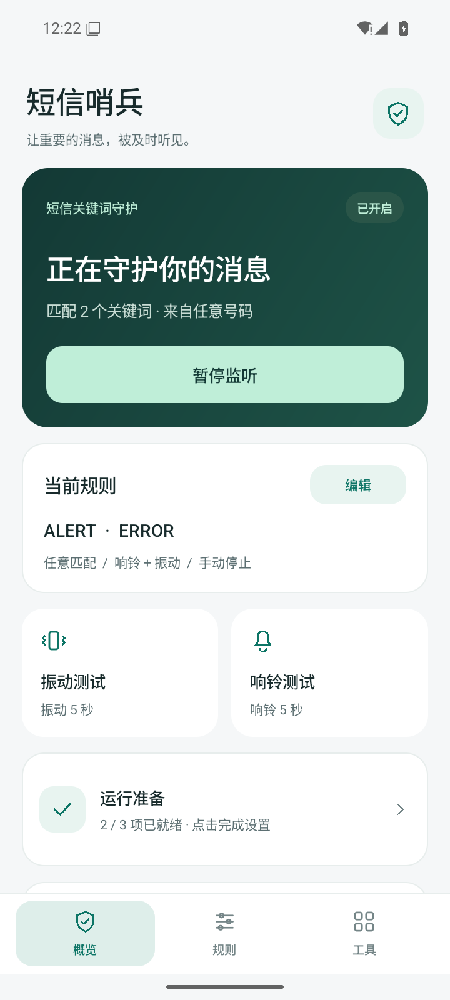
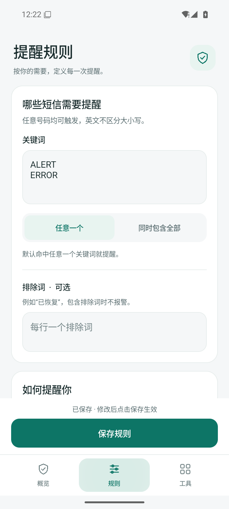
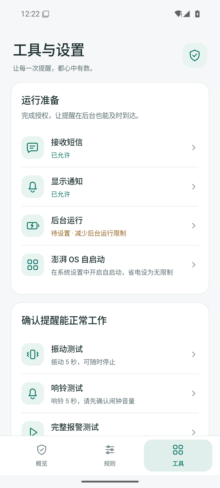
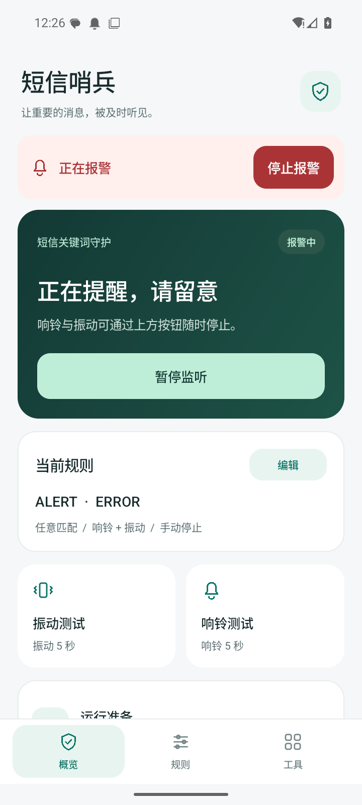

# 0.2.0 界面更新

本版将原来的长表单整理成三个页面，使用统一的深墨绿、浅灰背景、白色卡片和线条图标。

| 页面 | 用途 |
| --- | --- |
| 概览 | 查看监听状态，开启/暂停监听，预览当前规则，快速测试振动或响铃 |
| 规则 | 编辑关键词、排除词和匹配模式，选择响铃/振动及停止时间 |
| 工具 | 完成授权和后台设置，完整测试报警，检查短信匹配，复制诊断日志 |

## 使用变化

1. 在“规则”中设置后，点击固定在底部的“保存规则”。
2. 回到“概览”，点击“开启监听”；缺少权限时会引导到工具页。
3. 报警时，所有页面顶部都会出现红色“停止报警”入口。

保存规则与开启监听分开。修改正在使用的规则时，保存后继续监听；修改暂停中的规则不会自动开启。原有规则、权限和日志沿用，不需要卸载旧版。

## 交互细节

- 底部导航固定，切换页面保留草稿和各页滚动位置。
- 输入时显示“有未保存的修改”，保存按钮保持可用。
- 停止时间可选择手动、30 秒、60 秒或自定义，无需记忆“0”的含义。
- 切换页面使用 160ms 渐显，系统关闭动画时不播放过渡。
- 页面状态随配置和日志变化更新，取消原有每秒轮询刷新。
- 连续点击测试会提示先停止当前报警；匹配检查结果在同一弹窗更新。
- 支持系统字体放大；已检查 360dp 宽度、1.3 倍字体下的规则页。

## 实际界面

以下为 Android 16 模拟器中运行应用的截图，示例关键词仅存在于测试模拟器，不会预置进 APK。

### 概览

### 规则

### 报警方式与时长

### 工具

### 报警进行中

